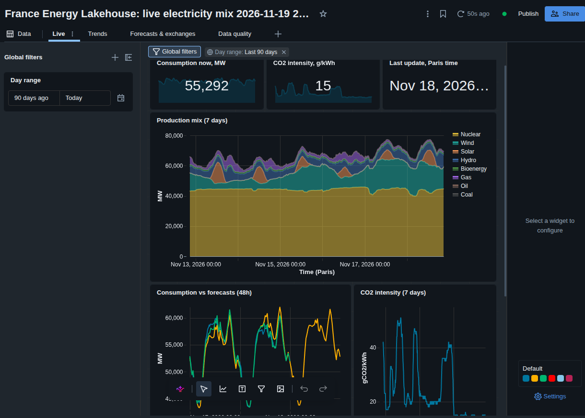
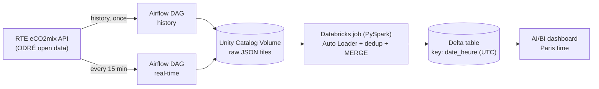
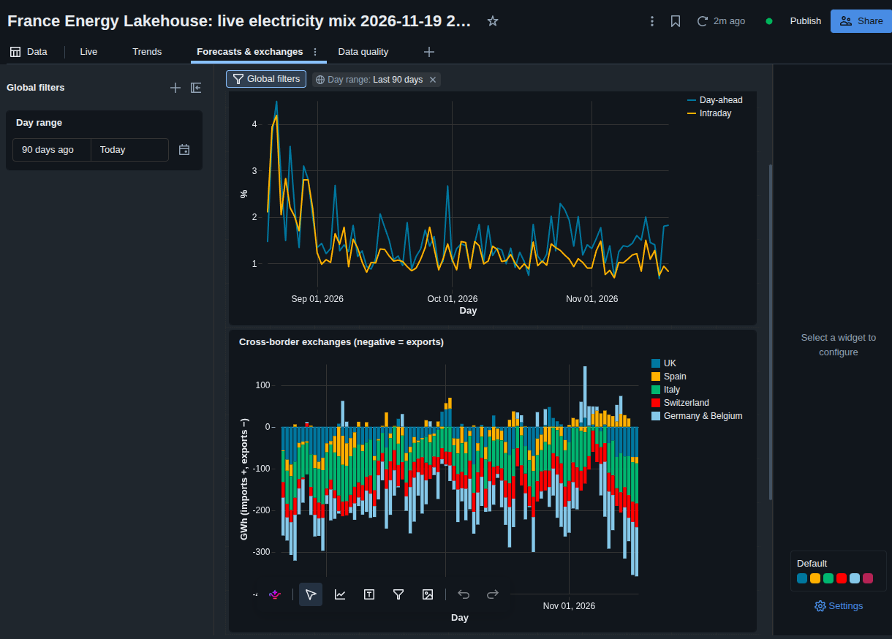

# France Energy Lakehouse

A live data lakehouse on **Databricks** built on France's national electricity data (RTE eCO2mix).
New data is collected every 15 minutes, landed as raw files, ingested incrementally, and upserted into a Delta table that always keeps the **best available version** of each 15-minute slot, as RTE replaces real-time estimates with consolidated and then definitive values.



<!-- Optional: link your 2-minute demo -->
**Demo:** [2-minute walkthrough](LINK_TO_LOOM)

---

## The problem this solves

RTE publishes the French electricity mix (consumption, production by source, CO2 intensity, cross-border exchanges) every 15 minutes. The same time slot changes value over time:

| Status (`nature`) | When it arrives | Quality |
| --- | --- | --- |
| Données temps réel | Within minutes | Estimate from telemetry |
| Données consolidées | Mid next month | Checked and completed |
| Données définitives | Second half of next year | Final, all meters verified |

The API also publishes the rest of today's slots in advance, with only forecasts and every actual value empty.

A naive "insert new rows" pipeline keeps the first version it sees forever: estimates are never corrected, and empty forecast rows never get their real values. This project solves that with an incremental, status-aware upsert.

---

## Architecture



## Tech stack

| Layer | Tool |
| --- | --- |
| Source | RTE eCO2mix via the ODRÉ Explore API (real-time dataset + consolidated/definitive history) |
| Orchestration | Apache Airflow (2 DAGs) |
| Storage | Databricks Unity Catalog: a Volume for raw files, Delta Lake for the clean table |
| Processing | PySpark on Databricks (serverless): Auto Loader, window functions, Delta `MERGE` |
| Serving | Databricks AI/BI dashboard on SQL datasets |
| Monitoring | Python logging + Delta `MERGE` operation metrics |

---

## How it works

1. **Collect.** Two Airflow DAGs call the ODRÉ API: one loads the history once; the other runs every 15 minutes and fetches the latest records (the last ~25 hours), so a missed run is filled automatically.
2. **Land.** Each run writes a JSON file to the Unity Catalog Volume `/Volumes/energy/energy/energy_volume/eco2mix-national-tr/`. Collection runs outside Databricks because Databricks Free Edition restricts outbound internet access.
3. **Ingest incrementally.** Auto Loader (`cloudFiles`, `trigger(availableNow=True)`) reads only the files added since the last run, using a checkpoint, and infers the schema.
4. **Clean each batch.**
   - Unwraps API envelopes (`results` / `records`).
   - Converts non-numeric sentinels such as `ND` to `NULL` with `try_cast`.
   - Drops rows without a key.
   - Keeps one row per `date_heure`: best status first, then rows with actual values, then the newest file.
5. **Upsert.** Delta `MERGE` on `date_heure`. An existing slot is updated only if the incoming version is at least as final and doesn't replace actual values with an empty forecast row. New slots are inserted.
6. **Serve.** SQL datasets convert to Paris time and compute daily energy, renewable share, CO2 intensity, forecast error, exchanges and data completeness for the dashboard.

### The upsert rule

```python
# Dedup inside the batch: one row per slot, best version first
order = [nature_rank("nature"),               # définitives > consolidées > temps réel
         F.col("consommation").isNull(),      # rows with real values before forecast-only rows
         F.col("_file_time").desc()]          # newest file wins a tie

# MERGE: update only when the new version is at least as final,
# and never replace real values with an empty forecast row
update_condition = """
  rank(s.nature) <= rank(t.nature)
  AND NOT (s.consommation IS NULL AND t.consommation IS NOT NULL)
"""
```

---

## Key design decisions

- **The key is `date_heure` as a UTC timestamp, not `date` + `heure`.** `date` and `heure` are Paris local time: on the last Sunday of October the hour from 02:00 to 03:00 happens twice, so a local-time key would collide. `date_heure` stays unique. Paris time is used only for display.
- **Status-aware MERGE.** A better value always replaces an estimate, never the reverse. This is what makes the table trustworthy months later.
- **Forecast rows are handled explicitly.** Future slots arrive with only `prevision_j` / `prevision_j1` filled. The tie-break and the `NULL` guard stop them from overwriting real values.
- **Incremental, not full reload.** The first version reprocessed every file on each run. Auto Loader with a checkpoint reads only new files, so cost no longer grows with the history.
- **Collect every 15 minutes, process hourly.** This stays well within the ODRÉ API quota (50,000 calls per month) and the Free Edition compute quota.
- **Secrets stay out of the code.** The DAGs authenticate with the Databricks SDK's default credential chain (`DATABRICKS_HOST` / `DATABRICKS_TOKEN` environment variables, else a `~/.databrickscfg` profile), so no token is stored in the repository.

---

## Data model

**Table:** `energy.energy.fr_enrgy` (Delta, Unity Catalog)

| Column(s) | Description |
| --- | --- |
| `date_heure` | **Key.** Start of the 15-minute slot, UTC timestamp |
| `date`, `heure` | Same slot in Paris local time (informational) |
| `nature` | Data status: temps réel, consolidées or définitives |
| `consommation` | Actual consumption, MW |
| `prevision_j1`, `prevision_j` | Day-ahead and intraday consumption forecasts, MW |
| `nucleaire`, `eolien`, `solaire`, `hydraulique`, `bioenergies`, `gaz`, `fioul`, `charbon` (+ sub-types) | Production by source, MW |
| `ech_comm_*`, `ech_physiques` | Commercial exchanges by border and physical exchanges, MW (negative = France exports) |
| `taux_co2` | CO2 intensity of production, gCO2/kWh |

## Dashboard

| Page | Shows |
| --- | --- |
| Live | Consumption now, CO2 intensity, renewable share, last update; production mix; last 7 days by source; actual vs forecast |
| Trends | Daily consumption, renewable share, monthly CO2 intensity, monthly energy by source, peak demand |
| Forecasts & exchanges | Day-ahead and intraday forecast error; daily exchanges by country |
| Data quality | Minutes since last real value; rows per day vs the expected 96; rows by status per month |

**Trends:** daily consumption, renewable share, CO2 intensity by month, daily peak


**Forecasts & exchanges:** RTE's day-ahead and intraday forecast error, and daily cross-border exchanges (France is a net exporter on most days)



**Data quality:** 15-minute slots per day against the expected 96, and rows by data status per month


---

## Repository structure

```
.
├── dags/
│   ├── eco2mix_history.py        # one-off historical load
│   └── eco2mix_realtime.py       # every 15 minutes
├── databricks/
│   └── fr_energy_ingestion.py    # Auto Loader + dedup + MERGE
├── sql/
│   └── dashboard_datasets.sql    # the dashboard's SQL datasets
├── docs/                         # screenshots and diagrams
└── README.md
```
<!-- Adjust file names to match your repo -->

## Getting started

**Prerequisites:** a Databricks workspace (Free Edition works for personal, non-commercial use), Apache Airflow 2.x/3.x, Python 3.10+.

1. **Create the catalog, schema and Volume** in Databricks:
   ```sql
   CREATE CATALOG IF NOT EXISTS energy;
   CREATE SCHEMA  IF NOT EXISTS energy.energy;
   CREATE VOLUME  IF NOT EXISTS energy.energy.energy_volume;
   ```
2. **Configure Databricks access for Airflow:** on the Airflow workers, either set the `DATABRICKS_HOST` and `DATABRICKS_TOKEN` environment variables, or create a profile in `~/.databrickscfg` and set the Airflow Variable `databricks_profile` to its name. Optionally set the Airflow Variable `energy_output_dir` to change where files are written locally. Never commit the token.
3. **Load the history:** trigger the history DAG once.
4. **Start the real-time DAG:** it runs every 15 minutes.
5. **Deploy the ingestion script** (`databricks/fr_energy_ingestion.py`) as a Databricks job scheduled hourly, with a failure email.
6. **Create the dashboard:** add each query from `sql/dashboard_datasets.sql` as a dataset in an AI/BI dashboard.

**Check that it works:**
```sql
SELECT nature, count(*) AS n_rows, min(date_heure) AS first_slot, max(date_heure) AS last_slot
FROM energy.energy.fr_enrgy
GROUP BY nature;
```

---

## Limitations

- Databricks Free Edition is for non-commercial use, with daily compute quotas; this project is a portfolio demo.
- If Airflow runs on a laptop, collection pauses while it's off; the next run fills gaps of up to ~25 hours.
- The first real-time → consolidated transitions for live data appear mid-month, when RTE publishes the previous month's consolidated data.

## Roadmap

- [ ] Load the full 2012-today history into the table
- [ ] Data quality checks (duplicate keys, 15-minute gaps in UTC, negative values) with a quarantine table
- [ ] pytest for the upsert rule + GitHub Actions
- [ ] Gold tables (daily mix, forecast error, exchanges) instead of dashboard queries
- [ ] Cost & quality report from Databricks system tables (before/after the incremental rewrite)
- [ ] Rename the table to `energy.silver.eco2mix` and add a raw Bronze table

---

## Data source

Data: **RTE eCO2mix**, published on [ODRÉ (Open Data Réseaux Énergies)](https://odre.opendatasoft.com/):
- [eCO2mix national real-time](https://odre.opendatasoft.com/explore/dataset/eco2mix-national-tr/)
- [eCO2mix national consolidated and definitive](https://odre.opendatasoft.com/explore/dataset/eco2mix-national-cons-def/)

See each dataset's page for its licence terms. This project is not affiliated with RTE.

## Author

**YOUR NAME** · Data engineer · [LinkedIn](LINK) · Open to Databricks and data platform work.
